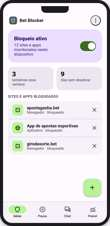
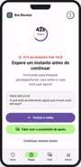
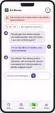
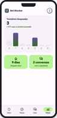

# Protótipo — Bet Blocker

Protótipo navegável do aplicativo **Bet Blocker**, direto aqui no GitBook — clique nas abas abaixo para alternar entre as telas, sem precisar sair da documentação.

Segue o padrão **Material Design 3** do Google, com paleta **roxo e verde**.




**Tela Inicial (bloqueio ativo)**

Tela principal do app. Mostra em destaque que o bloqueio a sites e apps de apostas está **ativo**, o tempo decorrido desde o início do bloqueio e atalhos para as demais funções: pausar, conversar com o chat de apoio e ver o painel semanal. Usa o roxo primário (M3) como cor de destaque para o card de status.




**Pausa temporária**

Permite ao usuário solicitar uma pausa temporária e consciente no bloqueio, com seleção de duração e uma etapa de confirmação — pensada para introduzir fricção e reflexão antes de liberar o acesso, evitando decisões impulsivas.




**Chat de apoio**

Canal de suporte dentro do app para momentos de vontade de apostar. Oferece mensagens de incentivo, dicas rápidas e orientação, com o verde secundário (M3) usado para reforçar tom de acolhimento e progresso positivo.




**Painel semanal**

Resumo visual do progresso do usuário ao longo da semana: tempo total de bloqueio, tentativas de acesso evitadas e evolução histórica. Usa gráficos e indicadores numéricos para reforçar o senso de conquista.



## Padrões visuais usados

* **Cores primárias (M3):** roxo `#6750A4` (primary) e `#D0BCFF` (primary container)
* **Cores secundárias (M3):** verde `#386A20` (secondary) e `#9DD47E` (secondary container)
* **Tipografia:** Roboto / Roboto Flex, seguindo a escala tipográfica do Material Design 3
* **Ícones:** Material Symbols Outlined
* **Componentes:** cards com elevação e cantos arredondados, navegação inferior, botões seguindo os estados (filled, tonal, outlined) do M3

## Experiência completa (opcional)

Além da navegação por abas acima, o protótipo também está publicado como um artefato interativo standalone, com transições e comportamento mais próximos do app real: [abrir experiência completa](https://claude.ai/artifact/E1fRNMyDZdzp9L27dSZFF9).

***

Veja também a Proposta do Projeto para o contexto completo do Bet Blocker.
